# Описание работы · ТЗ № ТЗ-20/2026 · «Чистый лист»

**Исполнитель:** Исмаилов Алишах Иса оглы, группа 11/1-РПО-26/1
**Сайт:** https://tz-20-klining-chistyy-list.vercel.app
**Период проверок:** 27.10.2026 — 01.11.2026

## 1. Задача заказчика

Компания «Чистый лист» получает запросы цены из Instagram, ВКонтакте, Telegram
и по телефону, но не знает, какой канал приводит клиентов, особенно тех, кто
переходит на регулярную уборку. В сентябре 2026 года пришло 520 запросов цены,
заказ оформили 230 человек; менеджер тратит на ручной расчёт 10–15 минут,
а на продвижение уходит 70 000 ₽ в месяц (письмо директора в ТЗ).
Задача — сайт с калькулятором и формой заказа, на котором видно источник
каждого посетителя, и одна таблица со всеми заявками и их статусами.

## 2. Схема работы

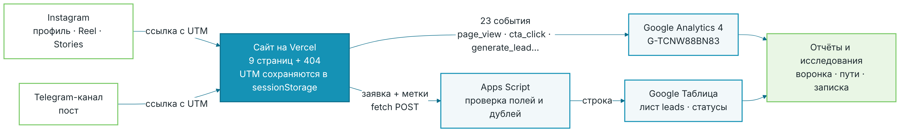

Посетитель приходит из Instagram или Telegram по ссылке с UTM-метками.
Сайт сохраняет метки в `sessionStorage`, отправляет события в GA4,
а заявку — через Apps Script в Google Таблицу вместе с метками.
По данным GA4 и таблицы собраны отчёты, исследования и аналитическая записка.

## 3. Сайт

Сайт из 9 страниц и страницы 404 создан с помощью нейросети Claude по ТЗ
и доработан: подключён тег GA4, добавлены отправка `form_submit`, режим
отладки `?debug_mode=1`, адрес приёмника заявок, ссылки на Instagram.
Опубликован на Vercel, обновляется после каждого push в `main`.
Lighthouse главной страницы: на телефоне 89 / 100 / 100 / 100,
на компьютере 87 / 100 / 100 / 100.

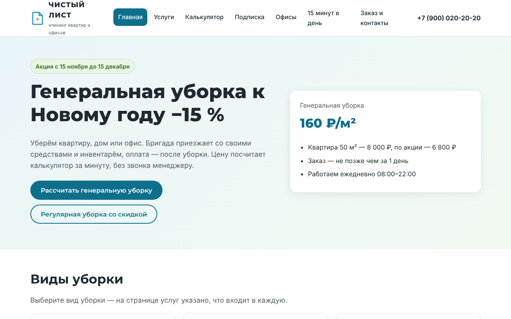
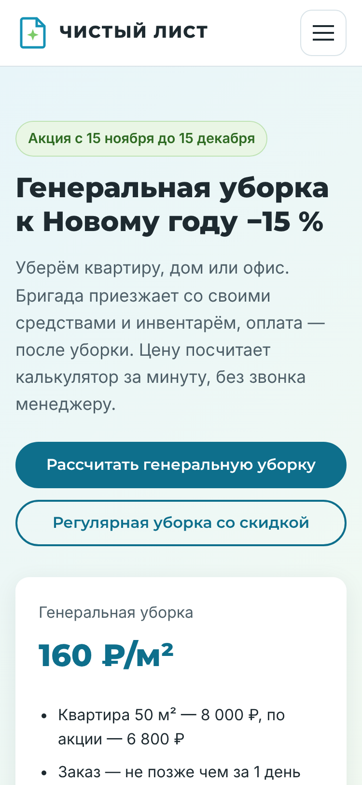
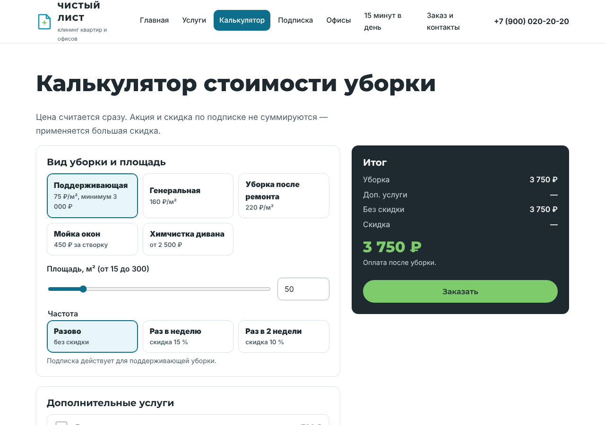
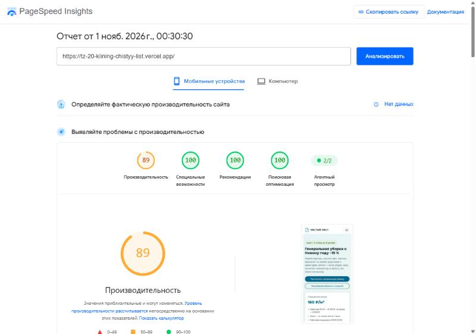

## 4. Аналитика GA4

Ресурс «ЧИСТЫЙ ЛИСТ — сайт», поток с идентификатором `G-TCNW88BN83`.
Настроено 20 событий (таблица — [`events.md`](events.md)), из них своих — 14.
Ключевые события: `generate_lead`, `contact_click`, `messenger_click`.
Зарегистрировано 7 пользовательских параметров (`button_name`, `page_section`,
`cleaning_type`, `extra_name`, `frequency`, `lead_cleaning_type`, `messenger`).
Каждое событие проверено в DebugView; в отчёте «События» видны все 23 названия
(с учётом `session_start`, `first_visit`, `user_engagement`).

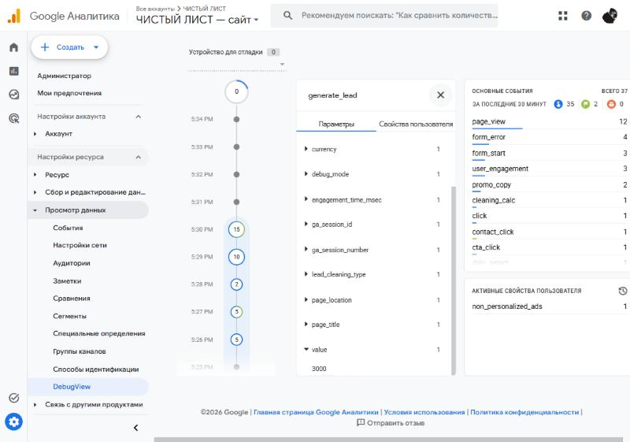
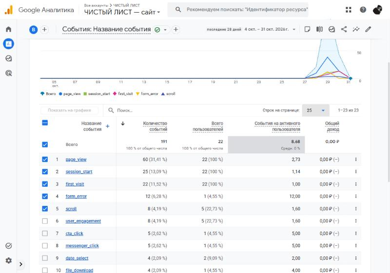
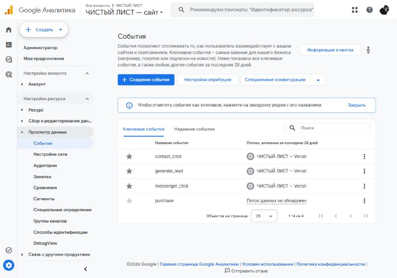

## 5. UTM-ссылки и соцсети

В реестре ([`utm.csv`](utm.csv), лист `utm` таблицы) 5 ссылок. По решению
преподавателя размещение выполнено в Instagram — ссылка в профиле (U-01)
и стикер-ссылка в Stories (U-04), — дополнительно сделан пост в Telegram-канале
(U-07). Полная ссылка в реестре собирается формулой из столбцов меток.

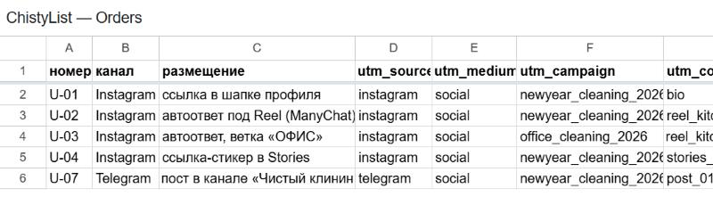
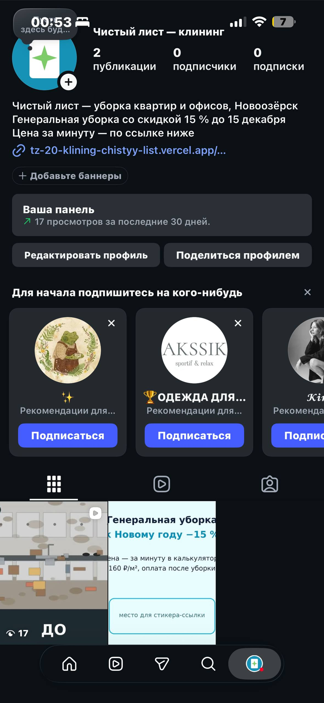
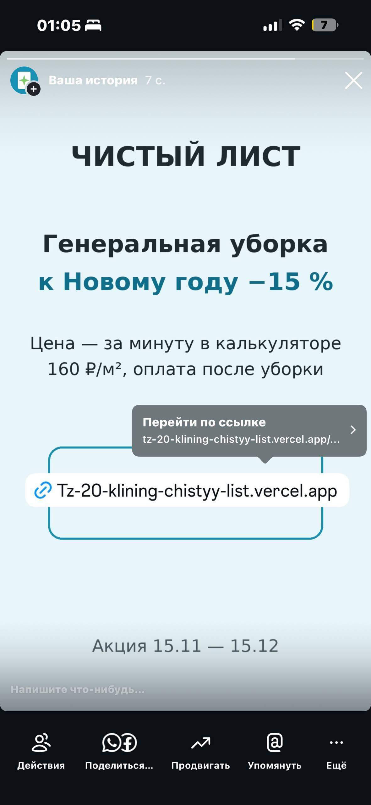
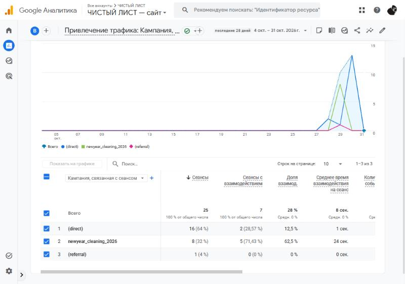

## 6. Заявки

Форма отправляет заявку в Apps Script, тот проверяет поля (имя, телефон
`+7XXXXXXXXXX`, вид уборки, площадь 15–300 м², дата не раньше завтра)
и записывает строку в лист `leads` вместе с метками. Повторная отправка
с тем же `request_id` не создаёт дубль. Статус заявки выбирается из списка
`new → contacted → confirmed → done / cancelled`.

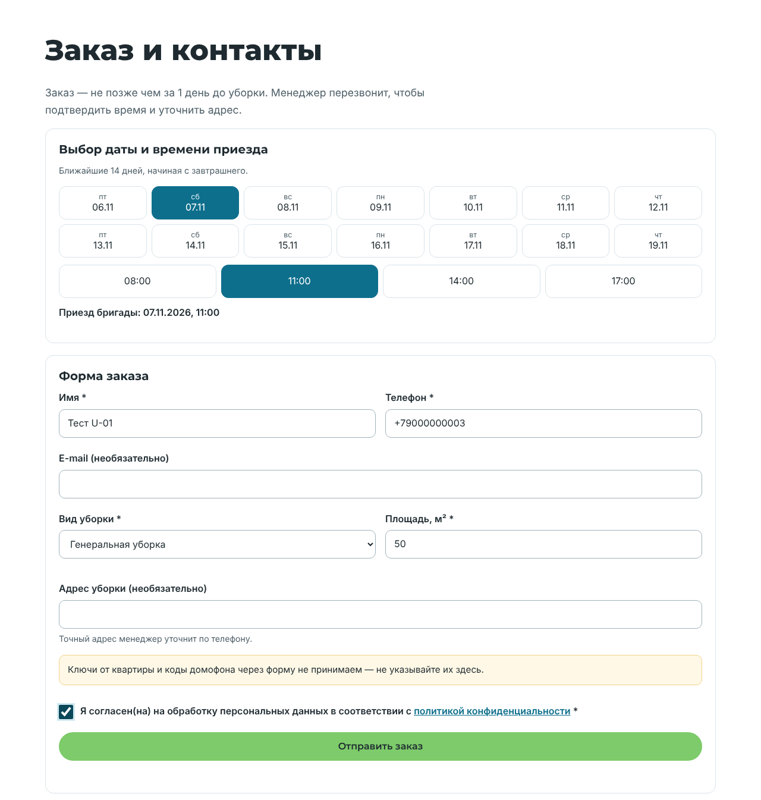
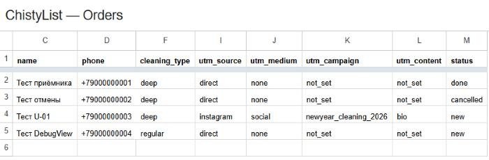

## 7. Автоответы в Instagram

Reel «Кухня до и после» опубликован, в подписи — призыв написать «ЧЕКЛИСТ».
Подключить ManyChat не получилось: в России Instagram открывается только
через VPN, и вход ManyChat в аккаунт не проходил подтверждение. Поэтому
автоответы «ЧЕКЛИСТ» и «ОФИС» не настроены, ссылки для них (U-02, U-03)
подготовлены в реестре.

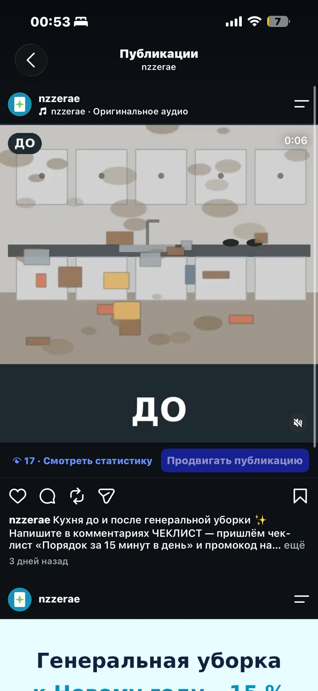

## 8. Отчёты

Открытая воронка показала наибольшую потерю между `page_view` и `service_view`
(22 → 1 пользователь, теряется 95,5 %). Instagram дал меньше сеансов,
чем прямые заходы (8 против 16), но доля взаимодействия у него 62,5 % против
12,5 %, и все 8 ключевых событий пришли из кампании `newyear_cleaning_2026`;
лучше всего сработал Reel (`reel_kitchen_01`, 7 ключевых событий).
Подробно — [`report.md`](report.md).

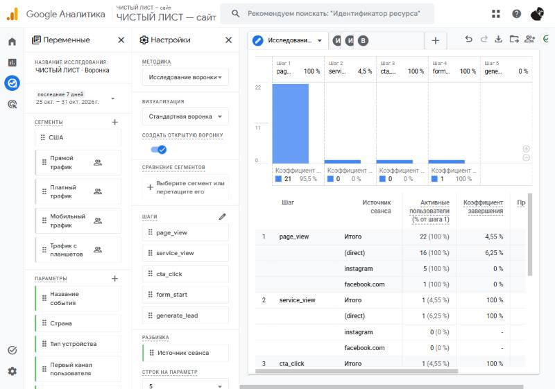
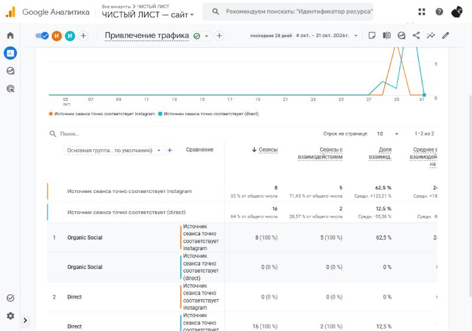
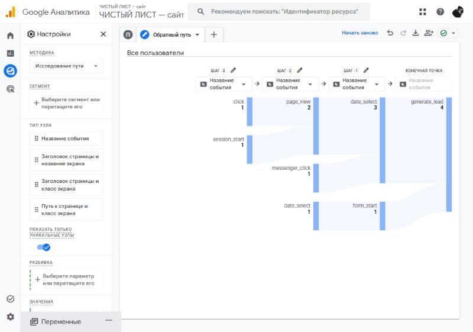

## 9. Что получил бизнес

| Было | Стало |
|---|---|
| цену считает менеджер вручную 10–15 минут | калькулятор на сайте считает цену сразу, с акцией и подпиской |
| запросы приходят в личные сообщения разных соцсетей | все заявки в одной таблице со статусом |
| источник клиента неизвестен | у каждой заявки есть source, medium, campaign, content |
| бюджет 70 000 ₽ делится «по ощущениям» | в GA4 видно сеансы и ключевые события по каждому каналу и размещению |

Рекомендация заказчику: вести ссылку из Reel и профиля Instagram сразу
на калькулятор и сравнить ключевые события на 100 сеансов до и после
(данные пока тестовые, вывод предварительный).

## 10. Итог

Не получилось: подключить ManyChat (вход в Instagram через VPN блокируется);
дашборд DataLens по решению преподавателя не делался.
ИИ использовался для: генерации кода сайта, помощи с настройкой GA4,
таблицы и отчётов и решения проблем, которые возникали при настройке.
Журнал запросов — [`prompts.md`](prompts.md).
